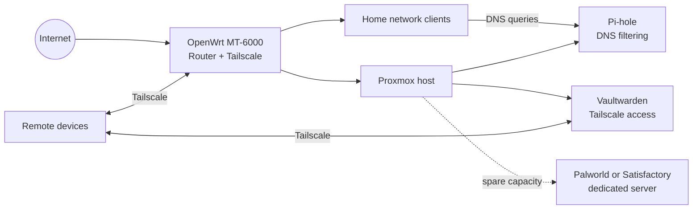

# Proxmox Homelab

A self-hosted setup built around Proxmox, OpenWrt, Pi-hole, and Tailscale. The goal is to host a privacy-focused set of services, make selected services reachable remotely, and leave room to host multiplayer game servers.

## What’s in the lab

| Component | Role |
|---|---|
| **Proxmox** | Virtualization host for the homelab services |
| **OpenWrt GL.iNet MT-6000** | Router; runs Tailscale and directs DNS requests to Pi-hole |
| **Pi-hole** | Network DNS filtering for clients using it as their DNS resolver |
| **Vaultwarden** | Self-hosted password manager, reachable through Tailscale |
| **Game servers (planned/available)** | Spare capacity for a Palworld or Satisfactory dedicated server |

## Hardware Overview
Proxmox Host:
| Component | Specification |
|---|---|
| **System** | HP EliteDesk 800 G6 Desktop Mini |
| **Processor** | Intel Core i7-10700 series, 8 cores / 16 threads, 16 MB cache |
| **Memory** | 16 GB DDR4 installed; 2 SODIMM slots, up to 128 GB supported |
| **Storage** | 512 GB installed; M.2 NVMe and 2.5-inch SATA drive support |
| **Networking** | Integrated Intel 1 GbE

Router: GL.iNet Flint 2 (GL-MT6000) 

| Component | Specification |
|---|---|
| **Router CPU** | MediaTek quad-core, 2.0 GHz |
| **Router memory/storage** | 1 GB DDR4 RAM / 8 GB eMMC |
| **Router Wi-Fi** | Wi-Fi 6 (802.11ax), AX6000; up to 1,148 Mbps on 2.4 GHz and 4,804 Mbps on 5 GHz |
| **Router Ethernet** | 1 × 2.5 GbE WAN, 1 × 2.5 GbE WAN/LAN, 4 × 1 GbE LAN; USB 3.0 |
| **Router role** | OpenWrt router with Tailscale; directs DNS requests to Pi-hole |

## Network overview

## Services and access
- **Pi-hole:** DNS filtering for network clients that use it as their resolver.
- **Vaultwarden:** Self-hosted password manager; remote access is through the Tailscale network.
- **Tailscale**: Reverse proxy run on router to allow external access to services.
- **Game servers:** Proxmox has headroom to run a Palworld or Satisfactory dedicated server when needed.

## Design goals

- Use local DNS resolving to filter traffic from junk domains and block ads.
- Use Tailscale for private remote access to selected services.
- Host Bitwarden locally to avoid vendor lock-in
- Host services on Proxmox and make use of available compute capacity.
---
